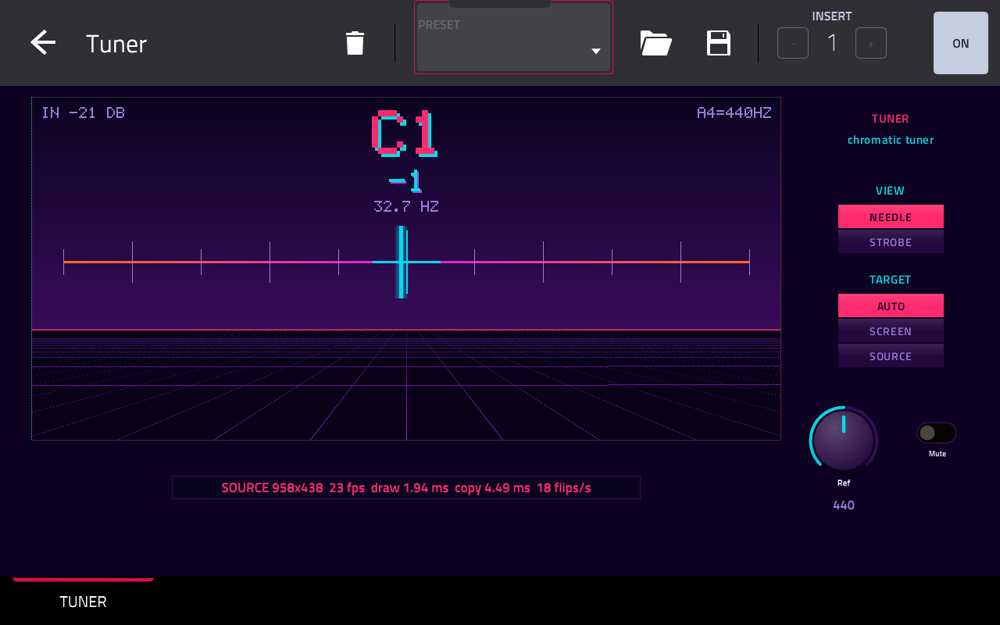
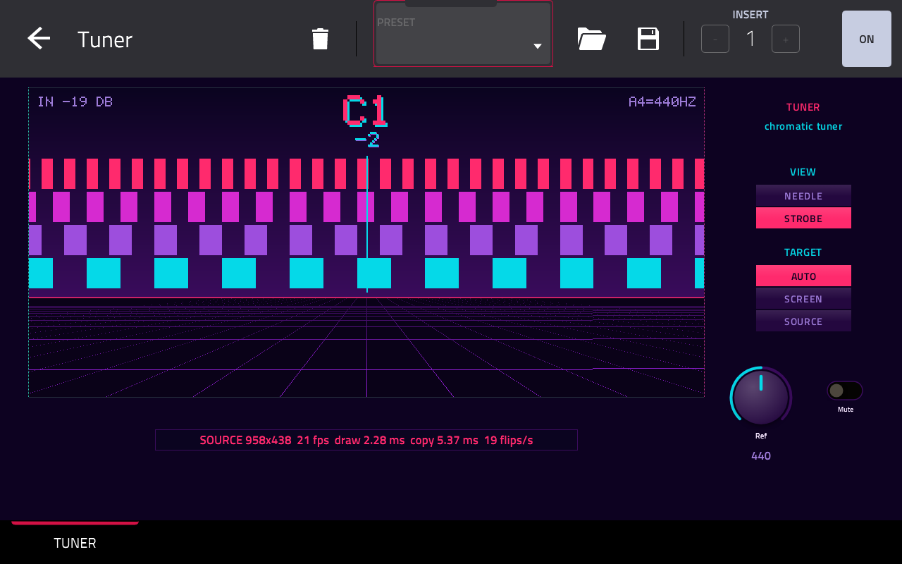

# Tuner

> [!WARNING]
> **This is not an Akai feature.** I'm not affiliated with Akai or inMusic, and they have nothing to do with this
> plugin. Tuner draws by writing straight into MPC's display memory, which MPC OS doesn't offer plugins, so a firmware
> update could break it. It was built with AI ([Claude Code](https://claude.ai/code)). If something goes wrong while
> you're using it, please **don't report it to Akai**. Open an issue
> [here](https://github.com/jacob-sabella/mpc-vst-tuner/issues) instead.

A chromatic tuner for the Akai MPC, in one insert effect.

Put Tuner on the track your guitar, bass or synth comes in on and play a note. It shows the note, how many cents
sharp or flat you are and the frequency, with a live needle or strobe drawn on the MPC's own touchscreen. It runs on
MPC OS standalone devices (MPC Live, One, X, Key and Force), loaded by MPC's built-in plugin host.



## Why it draws its own screen

An MPC plugin's screen is a skin: images and controls that MPC draws, and redraws when a parameter changes. That's
fine for knobs, but far too slow for a needle. Tuner's skin leaves a blank area, and the plugin draws into it itself,
20 to 24 times a second, from a background thread:

- **It finds its own area.** The blank area's left and right edges carry two colour patterns. The drawing thread looks
  for them on screen, so the screen size, rotation and header height aren't hard-coded.
- **It only draws while you can see it.** On another page, under a menu, or with another plugin open, the patterns
  are gone and it leaves the screen alone.
- **No flicker.** It draws into the buffer MPC paints its own UI into, so MPC shows Tuner's picture along with
  everything else on the page.

## Using it

Put Tuner on a track's insert (channel mixer > EFFECTS) and open it.

| Control | What it does |
|---|---|
| VIEW | NEEDLE or STROBE (below) |
| REF | the pitch of A4, 430 to 450 Hz (440 by default) |
| MUTE | silences the track while you tune. Tuner still hears it |
| TARGET | where it draws: AUTO (MPC's own buffer when it finds it, else the screen), SCREEN or SOURCE. Leave it on AUTO |

REF, VIEW and MUTE are on the first three Q-Links.

| View | What you see |
|---|---|
| NEEDLE | the note, the cents off and the frequency, with a needle over a ±50 cent scale |
| STROBE | the note and the cents, over four bands that drift left when you're flat and right when you're sharp. In tune, they stand still. The further off you are, the faster they move |

The cents turn cyan within 3 cents, yellow within 10, and pink beyond that. The input level is in the top left
corner. Below about -50 dB Tuner treats the input as silence: it keeps the last note dimmed for a second and a half,
then shows "---".



## Good to know

- Tuner follows one note at a time. A chord reads as the period its notes share, usually a low note: the
  screenshots above are of the Classic House demo's Rhodes chords, read as C1.
- It reads from 27 Hz to about 1.4 kHz, from a 5-string bass's low B to the 24th fret of a guitar's high E string.
  Offline, every test note lands within 0.4 cents (`tests/pitch_test.c`, 2026-10-26).
- The pitch detection runs on the drawing thread, never on the audio thread, and only while Tuner's page is on screen.
- A frame copied while MPC refreshes its own UI can tear for one frame: the scrolling floor lines show it most, split
  part of the way across (seen on a Key 37, 2026-10-26).
- With two Tuners in a project, the one inserted last draws (tested offline only).

## Installing

There's no release yet. Once there is, it will be in the
[MPC plugin catalog](https://sd88me.github.io/mpc-vst-plugins/) and on this repo's Releases page. Until then, build it
yourself (below) and install it like any other plugin from
[mpc-vst-plugins](https://github.com/sd88me/mpc-vst-plugins).

Tested on an MPC Key 37 (Gen1) with MPC OS 3.9.1 (2026-10-26). The Gen2 build (aarch64) compiles and passes the host
test under QEMU but hasn't been on a device.

## CPU

Measured on an MPC Key 37 (Gen1, RK3288, two cores) with MPC running, 2026-10-26. The work is on Tuner's drawing
thread, not in MPC's audio callback, so this is a share of one CPU core:

| Input | Drawing thread |
|---|---|
| silent, the page open | 7.2% of a core |
| a note sounding, the page open | 14.3% of a core |
| another page on screen | almost nothing: a few small reads per frame |

A frame takes 1.2 to 2.7 ms to draw and 1.4 to 5.4 ms to copy into MPC's buffer. On the audio thread Tuner only copies
each block into a buffer. mpc-vst-plugins' release bench (`tools/bench.sh`) hasn't been run yet.

## How it's built

- `src/engine.c` is the tuner, an [mpc-vst-plugins](https://github.com/sd88me/mpc-vst-plugins) engine. Each frame it
  runs YIN (de Cheveigné and Kawahara, 2002) on the last 93 ms of input, decimated to 11025 Hz, then measures the
  period again at 44.1 kHz around what YIN found, takes the median of the last five readings, and draws.
- `src/screendraw.c` finds the display, the blank area and MPC's UI buffer, runs the drawing thread, and copies each
  frame in. It checks the edge patterns column by column as it copies, so a page change halfway through a frame can't
  leave Tuner's pixels on the next page.
- `vst/` holds the plugin's definition: parameters, skin layout and the blank area's image (`vst/canvas.png`, drawn by
  `tools/make_canvas.py` from the colours in `src/screendraw.h`). `vst/params.lock` keeps the parameter order fixed, so
  Q-Link maps and automation in saved projects keep working after an update.

### Build and test

You need Docker (with QEMU for the ARM builds) and an mpc-vst-plugins checkout next to this one (or set
`MPC_VST=<path>`).

```sh
tests/run.sh     # offline tests on x86 under ASan/UBSan, then the wrapper's host test
vst/build.sh     # vst/build/tuner.so (armv7), vst/build/aarch64/tuner.so, the skin and the plugin-list entry
```

The pitch test plays 19 bass, guitar and synth notes, in tune, sharp, flat and against a 432 Hz reference, and checks
the note and the cents Tuner settles on. It also checks that silence clears the note, and pass-through and mute.

Releases come from CI. Run the Release workflow with a version, and it attaches both zips to a draft release. Install
that zip on a device, then publish the draft (as a prerelease while the version is 0.x).

## Vibe Coded

This project was built with [Claude Code](https://claude.ai/code): the pitch detection, the screen drawing, the skin
and the tests.

## Credits and license

The idea of a plugin drawing into MPC's display memory came from Lewinator56's experiments, shared with the MPC
plugin community. Tuner's code is its own.

Tuner is MIT (`LICENSE`).
